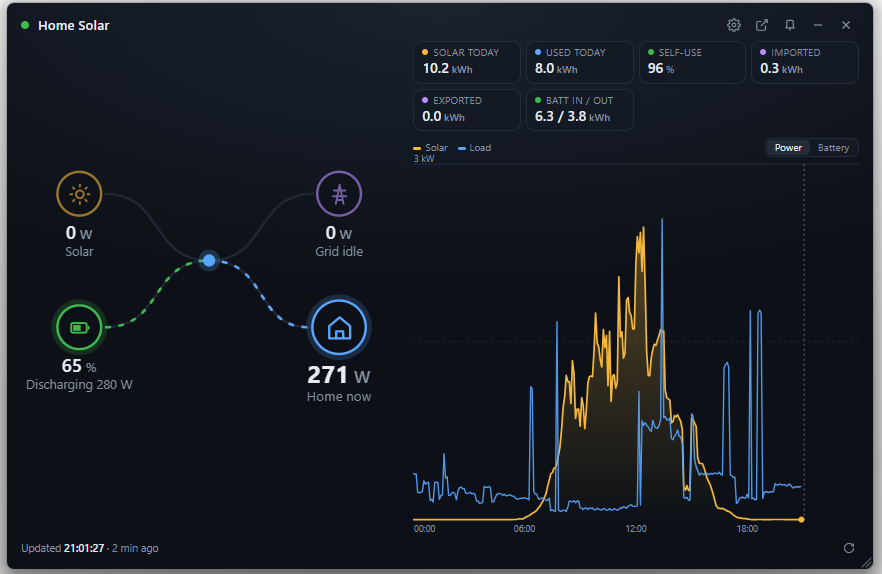
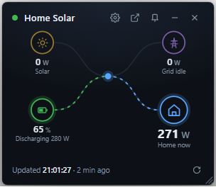

# Deye Cloud Widget

A small always-on-top desktop widget for Windows that shows your home solar / battery system live,
using your own [DeyeCloud](https://www.deyecloud.com/) account. Glance at it to see what the house is
using right now, whether the battery is charging, and whether the grid is up, without opening the website.

> Unofficial community project. Not affiliated with or endorsed by Deye. It only reads data from your own
> account through DeyeCloud's public developer API.



## Features

- **Live power flow** between Solar, Grid, Battery and Home, with animated flow lines that scale with power.
- **Battery state of charge** and whether it is charging or discharging.
- **Today's totals:** solar generated, energy used, imported, exported, battery in/out, and self-use %.
- **Day chart** of solar and load (or battery charge), with a hover tooltip.
- **Always the latest reading.** Each refresh checks both the station and the inverter and shows whichever is
  newer, so the widget matches what the DeyeCloud site shows. The footer shows the exact reading time
  (`Updated 14:32:10 · 2 min ago`) so you can compare the two directly.
- **Grid outage alerts:** a Windows notification when the grid goes down and when it comes back.
- **Resizable** by dragging the right edge, bottom edge or corner grip. Small sizes show just the diagram,
  wide sizes switch to two columns. Size and position are remembered.

  

- **Light and dark** theme, following Windows.
- **Always on top** toggle, minimise, and one click to open the full DeyeCloud station page.
- Optional **start with Windows**.

## Requirements

- Windows 10 or 11 (it uses Windows-only features: WebView2, Credential Manager, notifications)
- [Python 3.10 or newer](https://www.python.org/downloads/) (tick "Add python.exe to PATH" when installing)
- A DeyeCloud account with a station, and free DeyeCloud developer API keys (step 1 below)

## Quick start

1. **Get API keys**, see below. Takes about 5 minutes, one time.
2. **Download** this repository (green **Code** button, then **Download ZIP**, then extract it), or clone it:
   ```bash
   git clone https://github.com/Adore96/daye-cloud-widget.git
   cd daye-cloud-widget
   ```
3. **Run it.** Either double-click **`run.bat`** (creates a private Python environment and installs what it needs on
   the first run, then starts the widget), or do it by hand:
   ```bash
   python -m venv .venv
   .venv\Scripts\python -m pip install -r requirements.txt
   .venv\Scripts\python app.py
   ```
4. On first launch the widget shows a setup form. Fill it in and press **Connect** (see "First run" below).

### 1. Get DeyeCloud API keys

1. Go to <https://developer.deyecloud.com/> and sign in with your normal DeyeCloud account (the same email
   and password you use on deyecloud.com).
2. Open **Application**, then **Create application**. Any name works, for example "Desktop widget".
3. Copy the **App ID** and **App Secret**.
4. Note your **data center**. It is the region you chose when you registered your DeyeCloud account:

   | Setup form option | Developer site |
   |---|---|
   | India | `india-developer.deyecloud.com` |
   | EU / Africa / Asia-Pacific | `eu1-developer.deyecloud.com` |
   | Americas | `us1-developer.deyecloud.com` |

   A wrong data center fails with "auth invalid".

### 2. First run

Enter the data center, App ID, App Secret, and your DeyeCloud email and password. Leave **Station ID** blank to
use the first station on your account, or paste a specific one (it is the number in the station page URL:
`deyecloud.com/station/new-main?id=<station id>`). Press **Connect**.

To change anything later, click the gear icon. Leave the secret and password fields blank to keep the saved ones.

### Start with Windows (optional)

```bash
.venv\Scripts\python install_autostart.py            # add a Startup shortcut
.venv\Scripts\python install_autostart.py --remove   # remove it
```

## Using the widget

| Control | Action |
|---|---|
| Gear | Settings |
| Arrow out of box | Open the station on deyecloud.com |
| Pin | Toggle always-on-top (highlighted means on) |
| Minus / X | Minimise / quit |
| Circular arrow (bottom right) | Refresh now |
| Leaf (bottom right) | Low-power mode: stop the flow animation (highlighted means on) |
| Power / Battery tabs | Switch the chart |
| Drag the title bar | Move it |
| Drag right edge, bottom edge or corner | Resize (minimum 300 x 260) |

If no new data arrives for 15 minutes, the card dims and the footer turns amber.

### Resource use

Measured on a 2026 laptop (Intel graphics, 18 threads), whole widget including its WebView2 processes:

| State | CPU | RAM |
|---|---|---|
| Visible, flow animation on | about 8% of one core (under 1% of the whole CPU) | about 280 MB |
| Visible, low-power mode | about 1% of one core | about 280 MB |
| Minimised | about 1% of one core (animation pauses automatically) | about 280 MB |

Most of the RAM is the Edge WebView2 engine that draws the card. Network use is a few small HTTPS requests per
minute.

## How it works

- Polls DeyeCloud every 60 seconds (adjustable with `refreshSeconds`, minimum 30). Your inverter itself only
  uploads to the cloud about every 5 minutes, so you will see new numbers when the next upload lands.
- Each poll reads `station/latest` and the inverter's `device/latest` and uses whichever reading is newer.
  Daily totals and the chart are refreshed every 5 minutes to save API quota.
- The flow lines are moved by a small timer at 8 frames per second instead of a CSS animation. A CSS
  `stroke-dashoffset` animation makes WebView2 redraw at 60 fps and used about 40% of a CPU core.
- Grid outage detection uses the inverter's reported grid voltage when available (under 50 V means the grid is
  down). Otherwise it falls back to "no grid flow while the battery is powering the house". Cloud data is up to
  about 5 minutes old, so alerts can lag by that much.

## Privacy and security

- Everything runs on your PC. The widget talks only to the DeyeCloud API for your region. There is no telemetry
  and no other server.
- The **App Secret** and a **SHA-256 hash of your password** (the form the DeyeCloud API requires) are stored in
  **Windows Credential Manager** under the service name `DeyeWidget`. They are never written to a file and are
  not part of this repository.
- Other settings (data center, App ID, email, station ID, window size and position) are in
  `%APPDATA%\DeyeWidget\settings.json`. Logs are in `%APPDATA%\DeyeWidget\widget.log`.
- To remove everything the widget stored: delete the `%APPDATA%\DeyeWidget` folder and remove the
  `DeyeWidget` entries from Credential Manager (Control Panel, Credential Manager, Windows Credentials).
- Never share your App Secret. If you posted it by accident, delete the application on the developer site and
  create a new one.

## Troubleshooting

- **Footer shows a red warning:** hover over it for details, and check `%APPDATA%\DeyeWidget\widget.log`.
  "Offline" means no internet, "HTTP 401" or "auth invalid" usually means a wrong data center, App ID or secret.
- **A number is wrong or stays at a dash:** run `python app.py --dump` to print the raw API responses. Field names
  vary by inverter model, so please attach this output (with your IDs removed) when reporting an issue.
- **Widget does not start a second time:** only one copy runs at a time. Starting it again brings the first one
  to the front.
- **Opens off-screen:** if the saved position is on a monitor that is gone, the widget opens centred.
- **Preview the look without API keys:** `python app.py --demo` shows the widget with fake data.

## Development

```bash
python -m unittest discover tests        # run the tests
python app.py --demo                     # UI with fake data
python app.py --dump                     # raw API responses for your station
```

To iterate on the UI in a normal browser, serve the `web` folder (`python -m http.server --directory web`) and
open `http://localhost:8000/index.html?demo`.

```
app.py                window, JS bridge, outage alerts, settings persistence
deye_api.py           DeyeCloud API client and the "newest reading" logic
config.py             settings file and Credential Manager access
winutil.py            Win32 helpers (always-on-top, resize, single instance)
install_autostart.py  Startup shortcut helper
run.bat               one-click launcher (first run sets up a virtual environment)
web/index.html        the whole UI (HTML, CSS, JS)
tests/                unit tests
```

Pull requests and bug reports are welcome. The most useful reports include your inverter model and the output of
`python app.py --dump` with serial numbers and IDs removed.

## License

[MIT](LICENSE)
